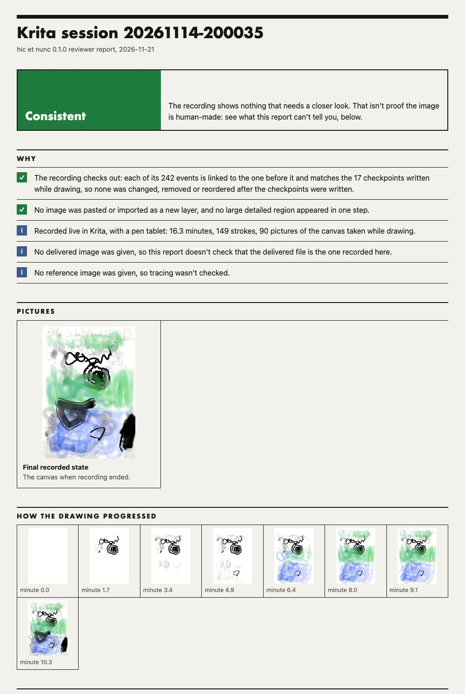
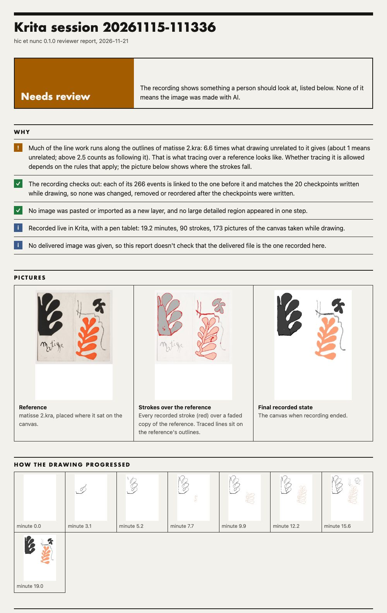

> _Even the most perfect reproduction of a work of art is lacking in one element: Its presence in time and space, its unique existence at the place where it happens to be._
>
> — Walter Benjamin

For around one month I worked on a side project with a simple premise: AI
detectors guess from the final image, but whether a human made a picture is a
fact about *how* it was made. Digital illustrators already record that. Procreate
saves a time-lapse of every stroke inside the project file. So why not check
the recording against the delivered image automatically, and give
illustrators a proof that holds up?

I wrote the code, then I went looking for someone who would pay for it. This
post is about what I found, because I think the findings are more useful than
the code (which is now [open source](https://github.com/andreanerla/hic-et-nunc)).

## The name and philosophy behind the project

The latin concept of [hic-et-nunc](https://it.wikipedia.org/wiki/Hic_et_nunc) (literally: here and now) has been interpreted in various ways by the different philosophical traditions. Walter Benjamin uses it in his essay ["The Work of Art in the Age of Mechanical Reproduction"](https://en.wikipedia.org/wiki/The_Work_of_Art_in_the_Age_of_Mechanical_Reproduction) to describe the spatial, temporal and cultural configuration in which the original work of art gets created and by which the work of art possesses an _aura_ which gets lost in the mechanical reproduction of the work of art. This process is not only destructive; Benjamin thinks that the reproduction of the work of art, and consequently its displacement of _hic et nunc_ and loss of _aura_, are also positive forces, by virtue of getting the masses closer to the work of art, even if in its reproduced version. If you're interested in it I suggest reading the whole essay, which is around 50 pages long.

My project is a humble attempt at reconstructing the process of creation of a digital work of art, somehow reproducing its _hic et nunc_ and bringing back its lost _aura_.

## The idea

An illustrator gives the tool her recorded process and the final image. The
recording can come from two places. One is a time-lapse read after the fact:
an exported video, or a Procreate file (that reader hasn't been tried on a real
file yet). The other is a recording made live in Krita with a plugin I wrote,
which logs every pen stroke and a snapshot of the canvas every five seconds in
a hash-chained log. Recording live turned out to be much stronger evidence than
reading a time-lapse afterwards, so Krita became the main path.

The tool runs on the illustrator's own computer and checks a few things:

- does the last recorded state match the delivered image,
- did the canvas start blank,
- are there large detailed regions that appear in one step (a pasted image),
- does the line work follow the edges of a declared reference (tracing), and
- does the delivered image differ locally from what was drawn (a signature, a logo, replaced content).

It doesn't say "AI" or "not AI". It writes one page for a
client or a jury: *consistent*, *needs review* or *inconsistent*, with the
reasons and what a reviewer should look at.

  <figure>
    
    <figcaption>A free drawing: <em>consistent</em>.</figcaption>
  </figure>
  <figure>
    
    <figcaption>Tracing over a Matisse: <em>needs review</em>.</figcaption>
  </figure>

## First problem: the cheap alternative is very good

The obvious substitute was detectors. A detector
like Hive costs about $0.006 per image. In an
[academic evaluation](https://arxiv.org/abs/2402.03214) it reached 98% accuracy
with 0% false positives on clean human art. Its weak spots are real but narrow:
false positives rose to about 3% on human art protected with Glaze, and Glaze
also cut its detection of AI images to around 68%. Invisible watermarks on AI
output are coming too (the EU AI Act requires machine-readable marking), but
[they can be removed](https://arxiv.org/abs/2306.01953).

So "is this AI?" is mostly answered for routine screening at well under a cent.
Process evidence only matters where a guess isn't good enough: a disputed
case, a prize, an accusation.

## Second problem: the "human-made" market is crowded and nearly free

I found at least seven services that certify work as human-made, most launched
in the last two years (I think most of them are not live anymore, to be honest):

- some take a declaration (Stampr explicitly does not verify human creation);
- some check identity rather than the work (the Authors Guild's "Human
  Authored" mark says it is "not aware of any truly reliable way to test" a
  manuscript);
- some have reviewers look at sketches, layers and time-lapses by hand (Human
  Made Art at $1 per review, I've Made This for free, Proudly Human with
  reviewers and published limits on AI use).

The one that publishes numbers reports 36 certified works. There are more
"human-made" marks than demand for them. And every certifier that actually
reviews process evidence does it manually, which was the one gap I could see:
nobody analyzes the working file automatically.

I wrote to the certifiers that review by hand. One showed interest and
proposed a meeting, then went quiet; the others haven't answered.

## What happens to illustrators

Asking illustrators directly got me little. I DM'd on Instagram six of them; the one who
answered wasn't interested and didn't know anyone who'd had problems with AI
accusations. So I read (mostly on Reddit) through public accounts of illustrators accused of using
AI instead. They're selected for incidents, so they show *what* happens, not
*how often*:

- Accusations are common for artists who are visible online, and grow with
  visibility.
- People acting in good faith are usually convinced by one time-lapse, a
  sketchbook, or someone vouching.
- People acting in bad faith aren't convinced by anything. One moderator
  refused to look at a layered file; an artist drawing live at a market stall
  still got accused.
- Layer screenshots and edited speedpaints are increasingly dismissed as "super
  easy to fake".
- The money at stake is small: in one case a client withheld half of a $100
  commission.

A stronger proof doesn't help much with either group: the first already
believes cheap proof, the second won't believe any.

## Third problem: the people with an AI ban don't feel a problem

So illustrators won't pay for proof, and the buyer had to be someone who
*enforces* an AI rule.

Every major illustration competition I checked bans AI:

| Competition | Rule | Verification described in the rules |
|---|---|---|
| Bologna Illustrators Exhibition | AI tools "not permitted" | none |
| Society of Illustrators Annual | AI "at any capacity" not eligible | none |
| Communication Arts Illustration | no text-to-image submissions | hi-res files from winners |
| 3x3 International Illustration Show | no AI-generated images | hi-res files from winners |
| Illustration West | entrant warrants work isn't mainly AI | none |
| San Diego Comic-Con Art Show | AI "partially or wholly" not allowed | the coordinator decides |

I believe most of these competitions received on the order of tens of thousands of illustrations per year - there's no way to manually AI-check all of them.

Then I wrote to the organizers: six competitions and platforms, some of them
in the table. Three answered:

- One said the rule keeps most AI work out. Some had still been entered, and
  some had even been **selected as winners**; they usually find out when they
  ask winners for more material. They didn't see a tool being useful for their
  process.
- Another called "no AI" an honor system, and doubted AI entries reach them at
  all, given how opposed illustrators are to AI.
- A commission platform said it couldn't disclose how it enforces its AI
  policy.

I also wrote to about a dozen children's book publishers, and one agreed to an
interview. It commissions 100 to 500 illustrations a year, half from new
illustrators, and has never once doubted one. They follow the sketches as the
work progresses and rely on a "no AI" clause in the contract.

Put together: the rule is there, enforcement is light, and nobody experiences
that as a cost. You can't sell a painkiller to someone who isn't in pain.

## The threat to the whole approach

Process evidence has its own expiry date. AI agents that operate software can
already draw stroke by stroke in a real app, which would produce a genuine
recording of a process no human performed. The moment AI images get good
enough that juries *and* crowds can't tell, process recordings may get easier
to fake too. And when demand does arrive, the cheapest answer is the drawing
app itself exporting a signed time-lapse, not a third party analyzing it. My
Krita plugin is a step in that direction, but it's a plugin anyone can install
and its log is written on the illustrator's own machine, so a determined forger
could rebuild it. 

## What went well

- Shaping the product with Claude was way more fun than I expected. I learned a lot on product management and on how to guide Claude (or let it guide me). More on that below.
- The experience of free-hand drawing was something I missed doing, even though I suck at it.
- I think the product will be useful for illustrators and competitions, even in this unfinished version.
- I finally managed to kickstart my blog, and write some thoughts that were cluttering my mind.

## What went wrong

I would've liked to create more human connections on this journey. Never say never, though. 

## What's left

The code is [on GitHub](https://github.com/andreanerla/hic-et-nunc) under AGPL.
If you run a competition, a certification service or a commission platform and *do* spend
time checking process files by hand, I'd like to hear from you. If you're an illustrator and planning to use my product, I'd love to hear from you.

## Have you used AI to create this product?

Indeed; I've let the AI produce the code and basically never checked the codebase myself. What I did was control the ideas (more on how [below](#how-i-ran-claude-on-it)).  
To me the code needed for this product was never the point. It was just a means to an end, and it would've been far from being a work of art anyway. 
Moreover, my view on the relation between AI and art is not simply "AI should be kept away from the realm of art". I've already witnessed fruitful blends of AI in art in the field of [music](https://en.wikipedia.org/wiki/Exai) and [painting](https://en.wikipedia.org/wiki/Edmond_de_Belamy). In chess, the most artistic moves I've seen were made by Stockfish or similar engines; Matthew Sadler writes about it at length in his great book [The Silicon Road to Chess Improvement](https://www.amazon.com/dp/9056919830). With that said, I think it's useful to understand _how_ a work of art was made, that's the ethos behind my product.

### How I ran Claude on it

One Claude Code session per task, steered by the repo's control files and gated by me at three points. Sources: `CLAUDE.md`, `PROMPTS.md`, `.claude/settings.json` and decision D-013 in the [repo](https://github.com/andreanerla/hic-et-nunc).

<pre class="mermaid">
flowchart LR
  A(["Me"])

  subgraph CTRL["Control files (repo)"]
    direction TB
    CM["CLAUDE.md rules, loaded automatically"]
    PR["PRODUCT_RULES.md decision order"]
    SP["SPEC.md scope"]
    DE["DECISIONS.md append-only"]
    ST["STATE.md current task, queue, known problems"]
  end

  subgraph CC["Claude Code session (one task)"]
    direction TB
    S1["1 Start read SPEC, DECISIONS, STATE 5-line reply"]
    S2["2 Plan files, approach, not doing"]
    S3["3 Build smallest diff"]
    S4["4 Check pytest + real-data table"]
    S5["5 Wrap up rewrite STATE, add decisions, propose SPEC edit + commit"]
    S1 --> S2 --> S3 --> S4 --> S5
  end

  HK["Hook on every .py edit ruff check + format, blocks on error"]
  DATA[("Real recordings outside the repo HIC_ET_NUNC_KRITA_DATA")]
  CHAT["Claude chat reviews against PRODUCT_RULES and 'Done when'"]
  PUB["Public repo hand export of PUBLIC_FILES.txt"]

  A -- "prompt from PROMPTS.md" --> S1
  S1 -. "confirm task" .-> A
  S2 -. "approve plan" .-> A
  S5 -. "approve decisions, SPEC, commit" .-> A
  CTRL --> S1
  S3 --- HK
  S4 --- DATA
  S5 --> ST
  S5 --> DE
  A --> CHAT
  CHAT -. "review" .-> A
  A --> PUB
</pre>

- **Solid arrow**: input or output, what Claude reads or writes.
- **Dotted arrow**: a gate, where Claude stops and waits for me.
- **Hook**: `.claude/settings.json`, PostToolUse on Edit/Write. Python rules
  Ruff can't check are in `.claude/rules/python.md`.
- **Chat review**: D-013. The decision record gives its context and reason as
  "unknown".
- **Not used**: project-defined subagents, skills, CI, scheduled agents, MCP
  servers.
